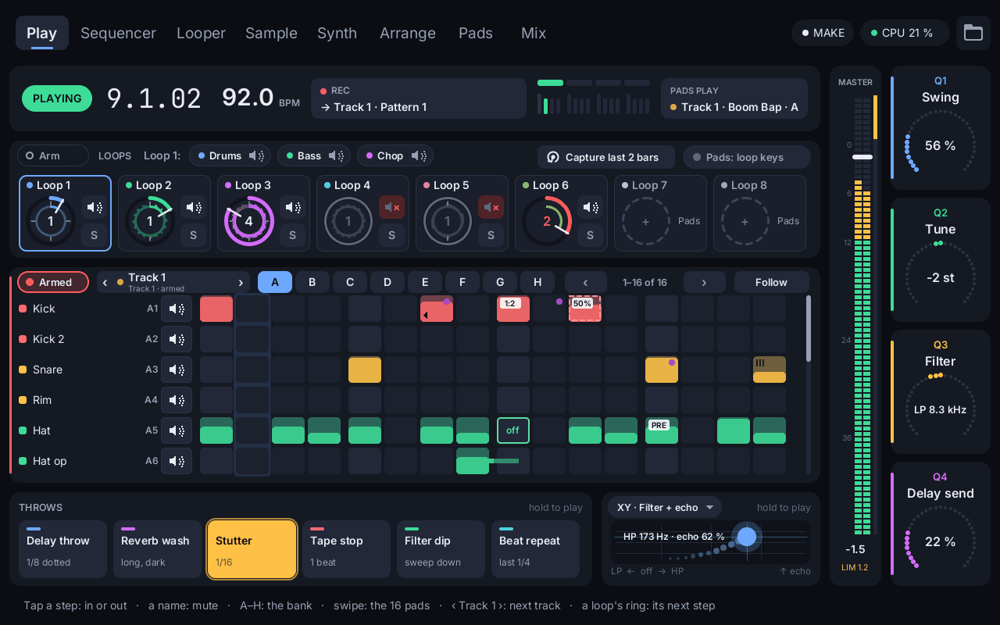

# MPFree

**Free, open-source software that turns an Akai MPC One into a new instrument.**

MPFree is a sampler, drum machine, synth, looper and sequencer that runs on the MPC One itself, with no computer attached. It keeps what makes an MPC fun to play: hitting pads, turning knobs and building a beat with your hands. Around that it adds a looper you can play like an instrument, twelve built-in synths, clips and scenes for playing live, and screens that show what they do, with fewer menus to dig through.

It is made for beatmakers and live performers alike, and it is free to use, change and share.

## Where it stands

MPFree is early test software, and there is no public release yet. It runs from a USB stick that you make on your computer with the MPFree USB creator: the MPC starts MPFree from the stick, and the MPC's own system and software are left exactly as they were. [Installing MPFree](docs/user/src/getting-started/installing.md) walks through it.

Most of what is described below is built and checked on a computer by MPFree's own automated tests. Trying it on the MPC itself is under way, one feature at a time.

## What you can do with it

MPFree is laid out as eight tabs across the top of the screen. Each name below links to its chapter of the manual.

- **[Play](docs/user/src/making-music/playing-live.md)** is the home screen. Your pads, the beat as rows of steps, your loops, an XY pad, and **throws**: effects you play like an instrument, such as Stutter, Tape stop and Reverb wash. Hold one and it comes in, let go and it stops.
- **[Sequencer](docs/user/src/making-music/sequencer.md)** is for building patterns step by step. Steps can be told to play only every other time or only on a fill, and each step can change a sound's settings just for that hit. There is also a piano roll, a note list and a tracker view.
- **[Looper](docs/user/src/making-music/looping.md)** has eight loops you record from the pads, a synth or the line input. Overdub layers, undo them, play a loop in reverse or at half or double speed.
- **[Sample](docs/user/src/making-music/sampling.md)** puts the whole sampler on one page. Record, trim, chop a break onto the pads, stretch it to the song's tempo, or turn it into a cloud of grains. **Keep last 4 bars** catches what you just played, even if you weren't recording.
- **[Synth](docs/user/src/making-music/synths.md)** holds twelve synths: Poly, FM, Drums, Pluck, Keys (electric piano and clav), Drawbar organ, Squelch acid bass, Analog, Strings, Bass, Wind (clarinet, sax and flute) and Choir. Any track can have its own.
- **[Arrange](docs/user/src/making-music/arranging.md)** launches clips and scenes for playing live, then lays them out as a song, with audio tracks and takes.
- **[Pads](docs/user/src/making-music/pads.md)** sets what each pad plays: a sample, a loop that stays in time, a synth note or a note to your other gear.
- **[Mix](docs/user/src/making-music/mixing-and-effects.md)** is the mixer, with an effect chain on every channel (compressors, EQ, delays, reverbs and more, with sidechain), plus your MIDI and CV connections and a monitor that shows every message coming in and going out.

Beyond the tabs:

- **[Other gear](docs/user/src/making-music/midi-and-cv.md).** Play it from MIDI keyboards over 5-pin MIDI or USB, including MPE. Turn a knob on your controller and MIDI Learn hands it the setting you touched. Sync to MIDI clock or send it, and play modular synths with CV and gate.
- **[Plugins](docs/user/src/making-music/plugins.md).** It hosts CLAP plugins and the MPC-format plugins people share. Each one runs apart from the rest of MPFree, so a plugin that crashes can't stop the music.
- **[Saving](docs/user/src/making-music/saving.md) and [exporting](docs/user/src/making-music/exporting.md).** Projects save with their samples and recordings, autosave every two minutes and keep the last ten saves. Songs export as a mixdown, as stems or as a MIDI file.
- **Staying in time.** If the MPC can't keep up, MPFree fades out the quietest notes instead of glitching, and tells you it did.

## Documentation

The docs are split by who they are for. [The docs index](docs/README.md) has all three.

**For musicians: [the user manual](docs/user/src/index.md).** It starts from zero, so no MPC experience is needed, and it builds as a website and a printable PDF. Good places to start:

- [Before you start](docs/user/src/getting-started/before-you-start.md) and [Installing MPFree](docs/user/src/getting-started/installing.md)
- [Your first beat](docs/user/src/getting-started/first-beat.md) and [your first loop](docs/user/src/getting-started/first-loop.md)
- [Coming from an MPC](docs/user/src/reference/coming-from-an-mpc.md): where MPFree works differently from the factory software
- [Buttons and controls](docs/user/src/reference/controls.md): every button and combination in one place
- [Moving your beats from the MPC](docs/user/src/making-music/moving-from-the-mpc.md)

**For developers: [the developer docs](docs/dev/README.md).** How MPFree is designed and why, with a page for each part of the app. Good places to start:

- [Architecture](docs/dev/project/architecture.md): how the pieces fit together
- [Roadmap](docs/dev/project/roadmap.md): what's done, what's next and what has to be proven first
- [Testing and CI](docs/dev/guides/testing-and-ci.md): the tests, and what every pull request is checked for
- [mpfree on the test build](docs/dev/guides/mpfree-app.md): running the app on an MPC One

**For AI agents** working on the code: [the agent docs](docs/agents/README.md) and [CLAUDE.md](CLAUDE.md).

## Building it

MPFree is written mainly in Rust. On a Linux computer with stable Rust installed, this builds everything and runs the tests:

~~~sh
cargo test --manifest-path rust/Cargo.toml --workspace --locked
~~~

[Testing and CI](docs/dev/guides/testing-and-ci.md) covers the rest of the tests, and [mpfree on the test build](docs/dev/guides/mpfree-app.md) covers running it on an MPC One.

## License

MPFree is under the [MIT license](LICENSE). That covers MPFree's own code and documentation. Its built-in fonts, Inter and JetBrains Mono, are under the [SIL Open Font License](rust/mpfree-ui/fonts/README.md).

MPFree is not made by or connected with Akai Professional. It does not include or share Akai's firmware, plugins, presets or sounds, and it does not get around their activation. See the [factory content policy](docs/dev/project/factory-content-policy.md).
